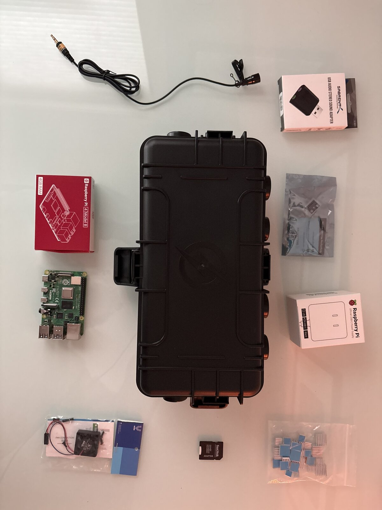
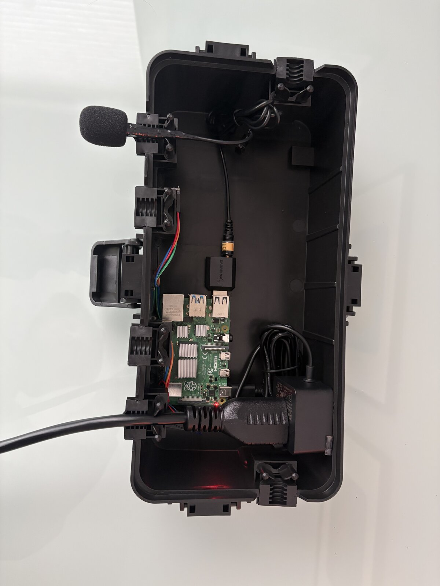
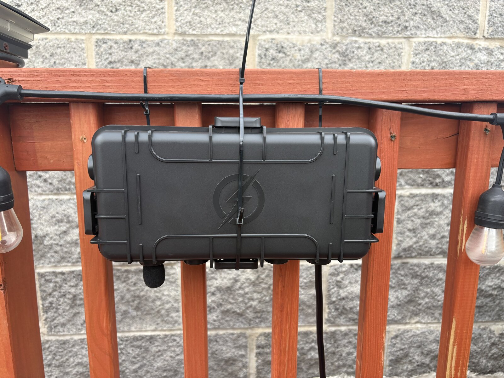
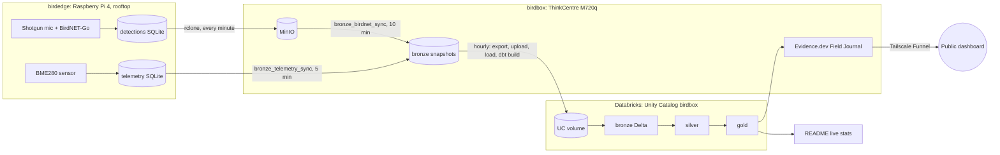

# Birdbox

[](https://github.com/ndataops/birdbox/actions/workflows/dbt.yml)
[](https://opensource.org/licenses/MIT)


A production-grade bioacoustic monitoring lakehouse running on a two-node home network — built to demonstrate end-to-end data engineering (ingestion, orchestration, transformation, and a live analytics dashboard, all running unattended) with genuine species detection enriched via eBird's taxonomy API.

**Note on citizen science integrations:** BirdNET-Go supports submitting detections to BirdWeather, but this requires uploading raw audio clips, and BirdWeather has no mechanism to submit detection metadata without the associated recording. After evaluating the privacy tradeoff, that integration is intentionally disabled here — this project prioritizes not capturing/sharing ambient audio over the citizen-science contribution. eBird's API is used read-only for species taxonomy lookups (no audio, no data leaves the device beyond the lookup query itself).

**Live demo:** [birdbox.tail69334c.ts.net](https://birdbox.tail69334c.ts.net)
**Repo:** [github.com/ndataops/birdbox](https://github.com/ndataops/birdbox)
**Incident log:** [docs/incidents.md](./docs/incidents.md) - deeper write-ups of the bugs below


## The physical build

| Before | Wired | Deployed |
|---|---|---|
|  |  |  |

Raspberry Pi 4, condenser mic, IP54 weatherproof enclosure, mounted on a rooftop railing. Full build story, hardware decisions, and how it ties into the reliability work: [docs/build.md](./docs/build.md).

## What it does

## What it does

A Raspberry Pi in a weatherproof rooftop enclosure (`birdedge`) runs [BirdNET-Go](https://github.com/tphakala/birdnet-go) against a shotgun microphone to detect and identify bird species from live audio, alongside a BME280 sensor logging temperature, humidity, and pressure. A Lenovo ThinkCentre (`birdbox`) on the same network pulls that data on a schedule and, every hour, pushes it to **Databricks**, where dbt builds bronze/silver/gold Delta tables in Unity Catalog. A live dashboard, the "Field Journal," reads from the gold layer.

Everything (the sensor syncs, the Databricks refresh, the dashboard rebuild, even this README's stats) runs on Dagster schedules with no manual intervention. The stack recovers from a power outage on its own: the machine powers back on, systemd restarts every service, and an external heartbeat raises an alert if it doesn't.

## Stack

- **Ingestion:** BirdNET-Go, BME280 (I2C), MinIO (S3-compatible object storage)
- **Lakehouse:** Databricks Free Edition: Unity Catalog, Delta tables, serverless SQL warehouse
- **Transformation:** dbt-databricks, bronze/silver/gold medallion, data tests including an automated freshness check
- **Orchestration:** Dagster (asset-based; 5- and 10-minute ingestion, hourly Databricks refresh)
- **Dashboard:** Evidence.dev, static production build
- **Infra & ops:** systemd, Tailscale Funnel (public HTTPS demo), GitHub Actions CI, Healthchecks.io heartbeat, Discord alerting
- **Languages:** Python, SQL (Databricks SQL)

<!-- STATS:START -->
## Live stats

- **Detections:** 13,624
- **Species identified:** 143
- **Latest detection:** 2026-10-24 12:54 CT
- **Telemetry readings:** 13,404
- **Last updated:** 2026-10-24 18:05 UTC (auto-generated hourly from Databricks)
<!-- STATS:END -->

### Architecture



**Medallion layers** in Unity Catalog (`birdbox` catalog):
- **Bronze:** raw Delta tables loaded from birdedge snapshots (BirdNET-Go detections via MinIO, BME280 readings via direct pull)
- **Silver:** cleaned, deduplicated, typed (`int_bird_detections_cleaned`, `int_telemetry_cleaned`)
- **Gold:** analytics-ready facts (`fct_bird_detections`, `fct_detections_with_weather`, a nearest-15-minute join between detections and enclosure readings)

Timestamps stay in UTC through bronze and silver. Conversion to Chicago time happens only in gold.

**Orchestration**, all Dagster-scheduled:
- `bronze_telemetry_sync`: every 5 minutes
- `bronze_birdnet_sync`: every 10 minutes, pulling from MinIO
- `databricks_job`: hourly at :07. `databricks_refresh` (export, upload to a UC volume, load bronze Delta, `dbt build`), then `evidence_build`, then `update_readme`
- `backup_job`: daily snapshot backups

The original DuckDB implementation remains in `dbt-project/` as a rollback path until it's retired.

## Incidents found and fixed

Real production bugs, not staged for the portfolio, found while running and hardening the system. Full write-ups are in [`docs/lessons-learned.md`](docs/lessons-learned.md).

- **Unbounded cron stacking.** A `* * * * *` rclone sync had no lock protection; overlapping runs piled up and exhausted memory/CPU on the Pi, taking it offline. Fixed with `flock`-guarded cron.
- **Silent 6-day pipeline outage.** After moving Dagster to systemd, `dbt` resolved by bare name on `$PATH` — which worked in an interactive shell but not under systemd's minimal environment. The entire dbt layer silently stopped running; nobody noticed until a downstream chart came up empty. Fixed with an explicit executable path.
- **A pipeline that never existed.** Bird detection sync from birdedge to the lakehouse had no automation at all — a one-time manual copy from early setup, never turned into a scheduled asset. Built a proper `bronze_birdnet_sync` asset pulling from MinIO, matching the existing medallion pattern.
- **Plaintext credentials in two places.** A MinIO secret was hardcoded in both `profiles.yml` and `docker-compose.yml`. Replaced with `env_var()`/`${VAR}` substitution backed by a single `chmod 600` secrets file — zero plaintext credentials anywhere in the codebase or git history.
- **A disk filled by build artifacts.** The dashboard went stale for about a week when the root disk hit 100%. The Evidence build step was merging hash-named output into the previous build without clearing it (47G vs. a ~115M clean build). Recovered with no data loss, because birdedge buffered the backlog.
- **A weather join off by ~10 hours.** A time zone conversion applied to an already-naive UTC timestamp shifted telemetry, so each detection was paired with readings from the middle of the night. Found by checking a gold row against raw sensor data, and fixed in the Databricks port with a rule: UTC until gold. The same check revealed the sensor reads enclosure temperature, not ambient, so it was relabeled.
- **A migration near-miss.** A failed `cd` let the rest of a command block write ~20 Databricks-port files into the live dbt project. Git showed the full blast radius, and it was restored with live data verified intact. The fix: chain dependent commands with `&&`, and experiment in a verified copy.
- **Eight silent days after a power cut.** The host lost power, stayed off due to a BIOS default, and nothing alerted, because failure alerts ran on the host itself. Fixed with auto power-on, retries, and an external heartbeat (see Operations).

## Operations

- **Self-healing:** BIOS set to power on after an outage; every service runs under systemd. Verified with a deliberate reboot: services, schedules, and the next Databricks refresh all recovered with no intervention.
- **Retries:** `databricks_refresh` retries up to 3 times with exponential backoff (1, 2, 4 minutes), riding out serverless cold starts and transient capacity errors on Free Edition.
- **Alerting, two layers:** a Dagster sensor posts failed runs to Discord, and each successful hourly run pings a Healthchecks.io heartbeat. If the pings stop for about 2 hours (host down, or Databricks failing repeatedly), Healthchecks alerts through Discord and email.
- **Durability:** birdedge buffers detections locally and syncs every minute, so a birdbox outage delays data rather than losing it.

## Skills demonstrated

- **Orchestration:** Dagster (asset-based scheduling, sensors, run-failure alerting)
- **Transformation & data quality:** dbt (medallion architecture, 23 tests, enforced data contracts, freshness checks)
- **CI/CD:** GitHub Actions on every PR: `dbt parse` of the Databricks project (models, refs, tests, YAML) and ruff linting of the Dagster pipeline
- **Infrastructure reliability:** systemd service supervision, automated backups, reboot-tested on real hardware
- **Observability:** Discord failure alerting, self-updating documentation, Healthchecks.io heartbeat
- **Data engineering judgment:** root-caused multiple production incidents, made and documented a privacy-vs-feature tradeoff decision
- **Full-stack delivery:** live public dashboard (Evidence.dev), interactive data catalog (dbt docs), physical IoT hardware
- **Cloud lakehouse:** Databricks (Unity Catalog, Delta, serverless SQL), migrated from DuckDB with parity verification

## Roadmap
- Incremental loads (MERGE) in place of full rebuilds
- Retire the DuckDB rollback path
- Natural-language query layer over the lakehouse
- Reusable "lakehouse spine" for sibling projects (air quality, transit, pollinators)

## Running it locally

```bash
git clone https://github.com/ndataops/birdbox.git
cd birdbox

# dbt
cd dbt-project && dbt build

# Dagster
cd ../birdbox_pipeline && dagster dev

# Dashboard
cd ../field-journal && npm install && npm run sources && npm run build && npm run preview
```

Requires exported `MINIO_ACCESS_KEY`, `MINIO_SECRET_KEY` for the MinIO-backed assets, and `EBIRD_API_KEY` for the taxonomy sync (free key at [ebird.org/api/keygen](https://ebird.org/api/keygen)).

## About

Built by Nelson Schicke — [LinkedIn](https://www.linkedin.com/in/nelsonschicke)
